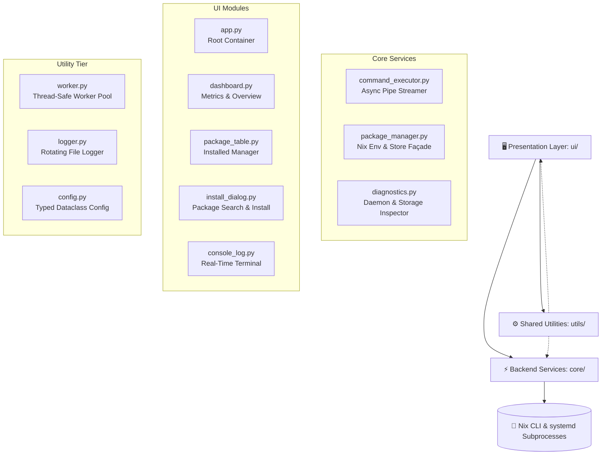

<div align="center">

# ❄️ NixManager Pro

**The Production-Grade Desktop Manager for Nix on Linux (Non-NixOS Ubuntu)**

[](https://www.python.org/)
[](https://nixos.org/)
[](https://ubuntu.com/)
[](https://opensource.org/licenses/MIT)
[](https://github.com/ambv/black)

<p align="center">
  A modern, asynchronous desktop control center built to manage your Nix packages, monitor system daemon health, inspect store disk usage, and trigger zero-latency garbage collection with a live real-time terminal output stream.
</p>

[Key Features](#-key-features) • [Architecture](#-architecture) • [Getting Started](#-getting-started) • [Usage Guide](#-usage-guide) • [Configuration](#-configuration) • [Troubleshooting](#-troubleshooting) • [Contributing](#-contributing)

---

</div>

## 📌 Overview

Running the **Nix Package Manager** on standard Ubuntu or Debian distributions provides declarative, reproducible package isolation alongside `apt`. However, managing multi-user environments, inspecting daemon health (`nix-daemon.service`), tracking `/nix/store` disk consumption, and parsing raw CLI outputs can be cumbersome.

**NixManager Pro** bridges this gap by delivering a lightweight, responsive, and reliable GUI. Engineered with clean separation of concerns:
- **Zero UI Freezing:** Background tasks run on dedicated thread pools with thread-safe event dispatching.
- **Live CLI Streaming:** Real-time stdout/stderr capture with color-coded log streams.
- **Robust Error Handling:** Comprehensive domain exceptions and non-zero process recovery.
- **Native Multi-User Readiness:** Designed specifically for non-NixOS Linux installations.

---

## ✨ Key Features

| Capability | Technical Details | User Benefit |
|---|---|---|
| **📊 Real-Time Dashboard** | Monitors `systemctl is-active nix-daemon.service`, `nix-store --print-stats`, and active channels | Instant visibility into system daemon health and storage metrics |
| **📦 Installed Packages Table** | Parses `nix-env -q`, displays name and version with Treeview styling | View all installed tools and trigger clean single or batch uninstalls |
| **🔍 Search & Installer** | Interactive search querying `nix-env -qaP` asynchronously | Discover Nix packages by attribute path and install with one click |
| **🖥️ Live Console Stream** | Subprocess pipe hooks streaming lines via `asyncio.StreamReader` | Observe real-time compilation, download progress, and GC execution |
| **🧹 One-Click GC** | Safe dispatch of `nix-store --gc` on background workers | Reclaim gigabytes of orphaned store derivations without locking the desktop |
| **📜 Centralized Logging** | 5 MiB rotating file logger (`logs/nixmanager.log`) + console handler | Enterprise-ready diagnostic audit trails for every operation |

---

## 🏛️ Architecture & Project Structure

NixManager Pro enforces strict decoupling across three specialized tiers:



### Directory Layout

```
NixManagerPro/
├── main.py                    # Application bootstrap & top-level exception handler
├── requirements.txt           # Minimal pinned dependencies (CustomTkinter)
├── pyrightconfig.json         # Strict language server & typing rules
├── README.md                  # Complete product documentation
│
├── core/                      # Core Nix & OS integration tier
│   ├── __init__.py
│   ├── command_executor.py    # Async subprocess wrapper with live stream hooks
│   ├── package_manager.py     # High-level Nix operations (install, uninstall, search, GC)
│   └── diagnostics.py         # Systemd daemon status, store disk usage, channels
│
├── ui/                        # Presentation tier (CustomTkinter)
│   ├── __init__.py
│   ├── app.py                 # Root CTk window & dependency injection container
│   ├── dashboard.py           # Metric status cards, action bar, and integrated table
│   ├── package_table.py       # Installed packages Treeview with context menu actions
│   ├── install_dialog.py      # Async package search & attribute-path installer
│   └── console_log.py         # Terminal output area with stream-colored tags
│
└── utils/                     # Concurrency, configuration, and logging tier
    ├── __init__.py
    ├── worker.py              # ThreadPoolWorker with queue-based dispatch
    ├── logger.py              # Rotating file handler (5 MiB x 3) + stderr streamer
    └── config.py              # JSON configuration schema with fallback defaults
```

---

## 🚀 Getting Started

### Prerequisites

1. **Linux OS**: Ubuntu 20.04+, Debian 11+, or any systemd-based Linux distribution.
2. **Python 3.10+**: With Tkinter installed:
   ```bash
   sudo apt update && sudo apt install -y python3 python3-venv python3-tk
   ```
3. **Nix Multi-User Setup**:
   ```bash
   sh <(curl -L https://nixos.org/nix/install) --daemon
   ```

### Installation

Clone the repository and prepare your isolated virtual environment:

```bash
# 1. Clone repository
git clone https://github.com/MikeeeDeV/NixManagerPro.git
cd NixManagerPro

# 2. Create and activate a Python virtual environment
python3 -m venv .venv
source .venv/bin/activate

# 3. Install dependencies
pip install --upgrade pip
pip install -r requirements.txt

# 4. Launch NixManager Pro
python main.py
```

---

## 💻 Usage Guide

### 1. System Health & Dashboard
Launch the app to immediately view three real-time telemetry cards:
- **Daemon Indicator**: Displays `🟢 active` if `nix-daemon.service` is operational.
- **Store Size**: Automatically measures the total size of `/nix/store`.
- **Channel Info**: Displays currently registered channels (e.g. `nixpkgs`).

### 2. Package Management
- **View Installed Packages**: Automatically loads your active environment's packages (`nix-env -q`).
- **Uninstalling**: Select one or more packages in the list, right-click, and select **Uninstall** (or click the red toolbar button). A confirmation dialog safeguards against accidental removal.

### 3. Searching and Installing
- Navigate to the **⬇ Install** tab.
- Type any query (e.g., `ripgrep`, `htop`, `neovim`, `zsh`) and press Enter.
- Select the desired package attribute path (e.g. `nixpkgs.ripgrep`) and click **Install Selected**.
- Switch to the **🖥 Console** tab to observe live download and build output.

### 4. Garbage Collection
- Click **🧹 Garbage Collect** on the Dashboard.
- Dead links and unreferenced store paths are purged cleanly in the background without UI hangs.

---

## ⚙️ Configuration

Custom settings can be defined in a `config.json` file in the root folder:

```json
{
  "max_worker_threads": 4,
  "log_level": "DEBUG",
  "theme_mode": "Dark",
  "colour_theme": "blue",
  "window_width": 1280,
  "window_height": 820
}
```

| Key | Type | Default | Description |
|---|---|---|---|
| `max_worker_threads` | `int` | `4` | Concurrency limit for background operations |
| `log_level` | `str` | `"DEBUG"` | Logging verbosity (`DEBUG`, `INFO`, `WARNING`, `ERROR`) |
| `theme_mode` | `str` | `"Dark"` | CustomTkinter appearance (`Dark`, `Light`, `System`) |
| `colour_theme` | `str` | `"blue"` | Accent palette theme (`blue`, `green`, `dark-blue`) |
| `window_width` | `int` | `1280` | Initial window width in pixels |
| `window_height` | `int` | `820` | Initial window height in pixels |

---

## 🛡️ Non-Blocking Architecture & Concurrency Model

A core architectural pillar of NixManager Pro is strict prevention of UI thread blocking:

```
[ User Action ]
      │
      ▼
( UI Thread - CustomTkinter )
      │
      ├─► worker.submit(task) ──► [ WorkerPool Queue ]
      │                                 │
      │                                 ▼
      │                     ( Worker Thread Execution )
      │                                 │
      │                                 ├─► asyncio.run(pm.install(...))
      │                                 │         │
      │                                 │         ▼
      │                                 │   [ AsyncCommandExecutor ]
      │                                 │         │
      │                                 │         ├─► readline() ──► callback()
      │                                 │                               │
      │                                 ▼                               ▼
      └◄── widget.after(0, update_ui) ◄─────────────────────────────────┘
```

1. **User interaction** immediately hands off execution to `WorkerPool`.
2. **Worker threads** execute `asyncio.run()` with the asynchronous command pipeline.
3. As `nix` outputs lines, the `set_output_callback` hook intercepts each line.
4. The callback schedules updates safely onto the main thread via Tkinter's `after(0, ...)`.

---

## 🔧 Troubleshooting

<details>
<summary><b>1. Nix daemon is reported as inactive or not found</b></summary>

Verify the status of the daemon via terminal:
```bash
systemctl status nix-daemon.service
```
If not running:
```bash
sudo systemctl start nix-daemon.service
sudo systemctl enable nix-daemon.service
```
</details>

<details>
<summary><b>2. Permission denied on /nix/store operations</b></summary>

Ensure your user belongs to the `nix-users` group or has access to the nix-daemon socket:
```bash
sudo usermod -aG nix-users $USER
```
Then log out and log back in for changes to take effect.
</details>

<details>
<summary><b>3. Missing tkinter on Ubuntu</b></summary>

Install the python3-tk package:
```bash
sudo apt install python3-tk
```
</details>

---

## 🤝 Contributing

Contributions, issue reports, and feature requests are welcome!

1. Fork the Project
2. Create your Feature Branch (`git checkout -b feature/AmazingFeature`)
3. Commit your Changes (`git commit -m 'feat: Add some AmazingFeature'`)
4. Push to the Branch (`git push origin feature/AmazingFeature`)
5. Open a Pull Request

---

## 📄 License

Distributed under the **MIT License**. See `LICENSE` for more information.

---

<div align="center">
  Crafted with care for the Linux & Nix Community by <b>MikeeeDeV</b>
</div>
