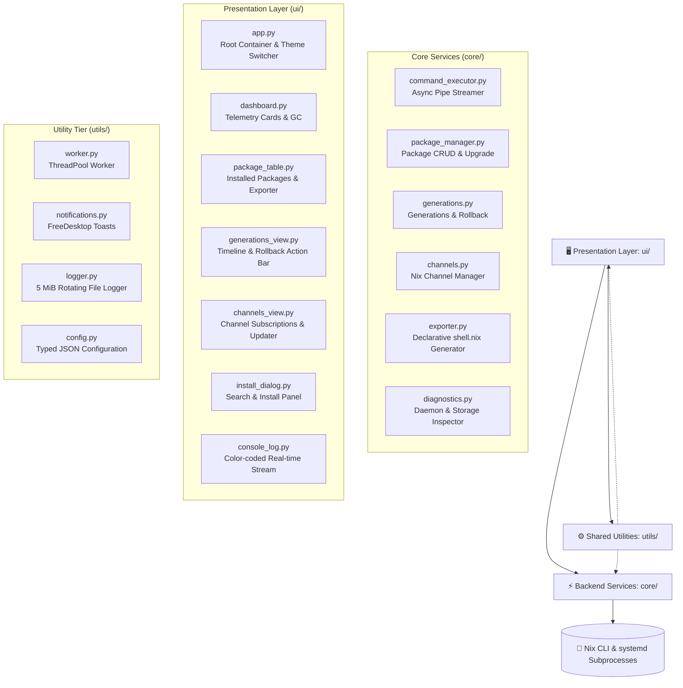

<div align="center">

# ❄️ NixManager Pro

**The Production-Grade, Asynchronous Desktop Control Suite for Nix on Ubuntu & Linux**

[](https://github.com/MikeeeDeV/NixManagerPro/actions/workflows/ci.yml)
[](https://www.python.org/)
[](https://nixos.org/)
[](https://ubuntu.com/)
[](https://opensource.org/licenses/MIT)
[](https://github.com/ambv/black)

<p align="center">
  A high-performance, non-blocking desktop client built to manage Nix packages, browse generation timelines with atomic rollbacks, configure upstream channels, export reproducible <code>shell.nix</code> environments, and monitor system daemon health with zero UI freezing.
</p>

[Key Features](#-key-features) • [Architecture](#-architecture) • [Desktop Installation](#-desktop-installation) • [Getting Started](#-getting-started) • [Usage Guide](#-usage-guide) • [Configuration](#-configuration) • [Contributing](#-contributing)

---

</div>

## 📌 Overview

Running the **Nix Package Manager** on multi-user Ubuntu or Debian installations provides declarative package isolation alongside native `apt`. However, managing transactions, reverting bad packages, tracking disk consumption across `/nix/store`, and editing channels via pure CLI can be challenging.

**NixManager Pro** transforms the Nix experience into a state-of-the-art desktop tool:
- **⚡ Atomic Generations & Rollback:** Browse historical states and revert transactions with one click.
- **📡 Channels Manager:** Inspect, subscribe, remove, and pull updates from upstream Nix channels.
- **📤 Declarative Exporter:** Generate reproducible `shell.nix` or JSON manifests from installed software.
- **🚀 One-Click Upgrades:** Upgrade every installed package via `nix-env -u` with live terminal streaming.
- **🔔 Native Desktop Notifications:** System toast alerts via `libnotify` when lengthy builds or cleanups complete.
- **🎨 Dynamic Theme Engine:** Switch between Dark, Light, and System themes on the fly.
- **🐧 Full Ubuntu Integration:** Ships with vector SVG icon and automated `.desktop` launcher installer.

---

## ✨ Key Features

| Capability | Module | User Benefit |
|---|---|---|
| **📊 System Telemetry** | `core/diagnostics.py` | Live `nix-daemon.service` status, uptime, store disk size, and channel inspection. |
| **⏱️ Generations & Rollback** | `core/generations.py` | Visual timeline of all package transactions with instant rollback (`--rollback`) and generation switching. |
| **📦 Package Manager & Upgrades** | `core/package_manager.py` | List installed packages, execute single or batch uninstalls, and run one-click upgrades (`nix-env -u`). |
| **📡 Channels Manager** | `core/channels.py` | Add custom nixpkgs channels, remove subscriptions, and trigger live updates (`nix-channel --update`). |
| **📤 Declarative Exporter** | `core/exporter.py` | Turn currently installed CLI & GUI tools into a reproducible `shell.nix` with `pkgs.mkShell`. |
| **🔍 Search & Installer** | `ui/install_dialog.py` | Query available derivations asynchronously via `nix-env -qaP` and install in background. |
| **🖥️ Live Console Stream** | `ui/console_log.py` | Real-time color-coded stdout/stderr output with automatic autoscroll and timestamp tags. |
| **🧹 Safe Garbage Collection** | `core/package_manager.py` | Purge unreferenced store derivations (`nix-store --gc`) or historic generations without locking the desktop. |
| **🔔 Desktop Notifications** | `utils/notifications.py` | Sends Ubuntu system toast alerts when background installations or cleanups finish. |

---

## 🏛️ System Architecture



---

## 🐧 Desktop Installation (Ubuntu / Debian)

To integrate NixManager Pro directly into your Ubuntu Application Launcher (Dash) without opening a terminal:

```bash
# Clone the repository
git clone https://github.com/MikeeeDeV/NixManagerPro.git
cd NixManagerPro

# Set up Python environment
python3 -m venv .venv
source .venv/bin/activate
pip install -r requirements.txt

# Run the automated desktop launcher installer
./install-desktop.sh
```

🎉 **NixManager Pro** will immediately appear in your Ubuntu App Grid under **System > Package Management**!

---

## 🚀 Quick Start (Manual Execution)

```bash
# 1. Activate environment
source .venv/bin/activate

# 2. Launch application
python main.py
```

---

## 💻 Usage & Tab Breakdown

### 1. 📊 Dashboard
- Real-time indicator for `nix-daemon.service` health.
- Store disk usage and channel summaries.
- One-click **Garbage Collection (`nix-store --gc`)** to reclaim disk space safely.

### 2. 📦 Packages & Export
- View all installed packages and their versions.
- **🚀 Upgrade All**: Upgrades every installed derivation to the latest available upstream release.
- **📤 Export shell.nix**: Generates a shareable, declarative Nix expression reproducing your exact environment.
- **🗑 Uninstall**: Single or multi-selection package removal with confirmation prompts.

### 3. ⏱️ Generations & Instant Rollback
- Displays all historical profile states created by transactions.
- Highlights the currently active `(current)` generation.
- **⚡ Instant Rollback**: Reverts your entire environment to the state prior to your last change.
- **Switch to Selected**: Jump backward or forward to any historical generation.
- **🧹 Delete Old**: Purge outdated generations to free up disk storage.

### 4. 📡 Channels Manager
- View registered channels (e.g. `nixpkgs`, `nixos-unstable`).
- Subscribe to new channel URLs with one click.
- **⬇ Update All Channels**: Pull latest channel definitions with real-time download output.

### 5. ⬇ Search & Install
- Search packages across the entire Nix repository asynchronously.
- Inspect attribute paths (e.g. `nixpkgs.ripgrep`, `nixpkgs.neovim`).
- Install with automated desktop toast notifications on completion.

### 6. 🖥 Console
- Dedicated terminal view color-coding stdout (`green`) and stderr (`red`).
- Monospaced timestamped log stream providing complete audit visibility.

---

## 🧪 Testing & Continuous Integration

NixManager Pro includes a comprehensive test suite executed on every commit and PR across Python 3.10–3.13 via GitHub Actions:

```bash
# Run unit tests locally
pytest tests/ -v
```

```
tests/test_command_executor.py::test_successful_command_execution PASSED
tests/test_command_executor.py::test_command_streaming_callback PASSED
tests/test_command_executor.py::test_failed_command_raises_error PASSED
tests/test_exporter.py::test_generate_shell_nix PASSED
tests/test_generations.py::test_parse_generations_list PASSED
```

---

## ⚙️ Configuration Schema

NixManager Pro reads `config.json` from the project root:

```json
{
  "max_worker_threads": 4,
  "log_level": "DEBUG",
  "theme_mode": "Dark",
  "colour_theme": "blue",
  "window_width": 1280,
  "window_height": 820,
  "export_manifest_path": "installed_manifest.json"
}
```

---

## 🤝 Contributing

Pull requests, feature requests, and bug reports are welcome!

1. Fork the Project
2. Create your Feature Branch (`git checkout -b feature/AmazingFeature`)
3. Commit your Changes (`git commit -m 'feat: Add AmazingFeature'`)
4. Push to the Branch (`git push origin feature/AmazingFeature`)
5. Open a Pull Request

---

## 📄 License

Distributed under the **MIT License**. See `LICENSE` for details.

---

<div align="center">
  Engineered with pride for the Linux & Nix communities by <b><a href="https://github.com/MikeeeDeV">MikeeeDeV</a></b>
</div>
